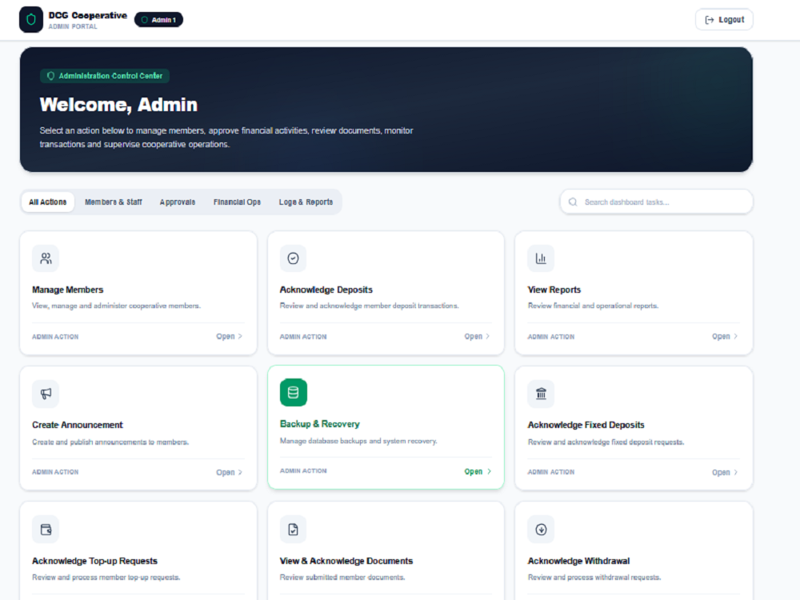

# Hi, I'm Emmanuel Alao 👋

### Full-Stack Web Developer | Building Modern Web Applications

I'm a Full-Stack Web Developer passionate about building responsive websites, business applications, management systems, dashboards, and database-driven platforms.

I work with modern web technologies to develop practical, user-friendly solutions that help businesses improve their operations. I also enjoy learning new technologies and sharing my knowledge through web development tutoring.

- 🔭 **Currently working on:** Full-stack web applications and management systems.
- 💻 **Core technologies:** Next.js, React, TypeScript, Node.js, and SQL databases.
- 🏗️ **Project focus:** Business websites, loan management systems, dashboards, and APIs.
- 🌱 **Currently learning:** Better application architecture, security, and deployment practices.
- 🤝 **Open to:** Remote opportunities, freelance projects, and collaborations.
- 🌍 **Location:** Abuja, Nigeria.

## 🌐 Portfolio

Explore my portfolio and development projects:

**[Visit My Portfolio](https://emmanuel-alao-portfolio.vercel.app/)**

## 🛠️ Technologies & Tools

### Frontend Development

### Backend Development

### Databases

### Tools & Deployment

## 🚀 Featured Projects

### 1. DCG Cooperative Loan Management System

A cooperative management platform focused on loan applications, member management, staff workflows, and loan processing.

**Technologies:** Next.js, React, TypeScript, MySQL, and Prisma.

- Implements role-based staff workflows.
- Supports loan application and processing features.
- Focuses on responsive interfaces and structured data management.

**Project status:** Under development.

### 2. Developer Portfolio

My personal portfolio showcasing my development profile, skills, and projects.

- **Live website:** [emmanuel-alao-portfolio.vercel.app](https://emmanuel-alao-portfolio.vercel.app/)
- **Source code:** [GitHub Repository](https://github.com/emmy-tech247/emmanuel-alao-portfolio)

## Screenshots

### Admin Dashboard

### Login Page

### Member Dashboard

## 🎯 What I Can Help With

- Responsive business websites
- Full-stack web application development
- Admin dashboards and management systems
- REST API development and integration
- Database-driven applications
- Website bug fixes and feature improvements

## 📫 Let's Connect

I'm open to connecting with developers, businesses, recruiters, and clients looking for web development support.

- **GitHub:** [@emmy-tech247](https://github.com/emmy-tech247)
- **Portfolio:** [My Portfolio](https://emmanuel-alao-portfolio.vercel.app/)
- **Email:** alaoemmanuel1978@gmail.com

---

⭐ Thank you for visiting my profile!

*Building useful digital solutions, one project at a time.*
